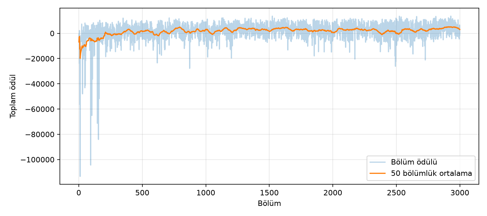
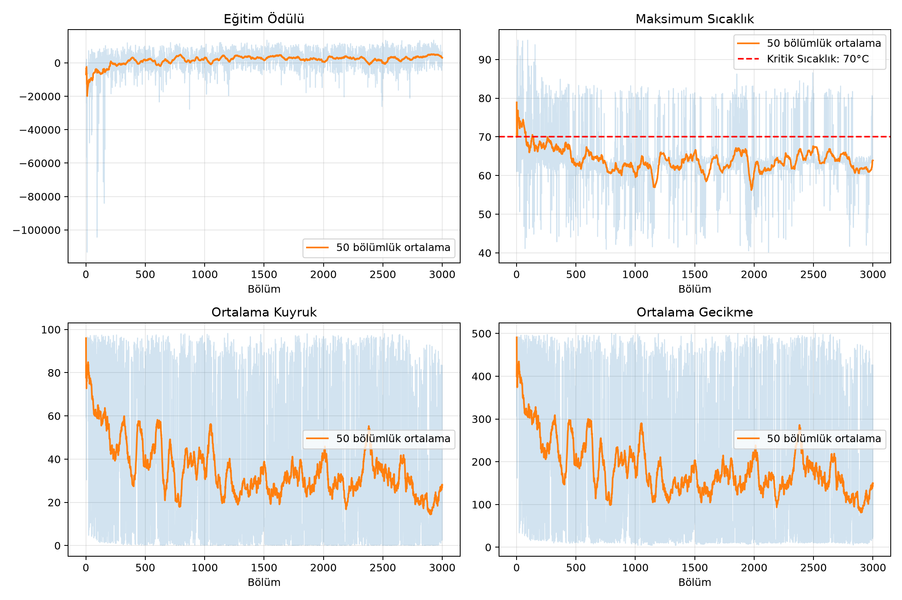
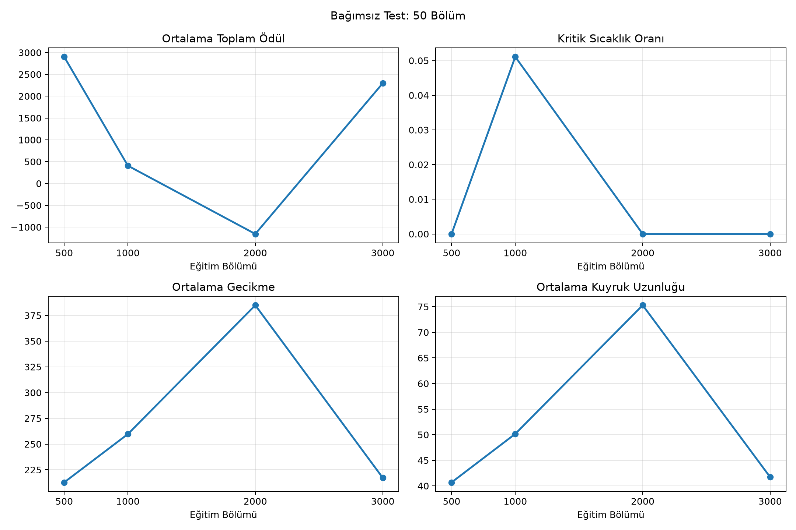
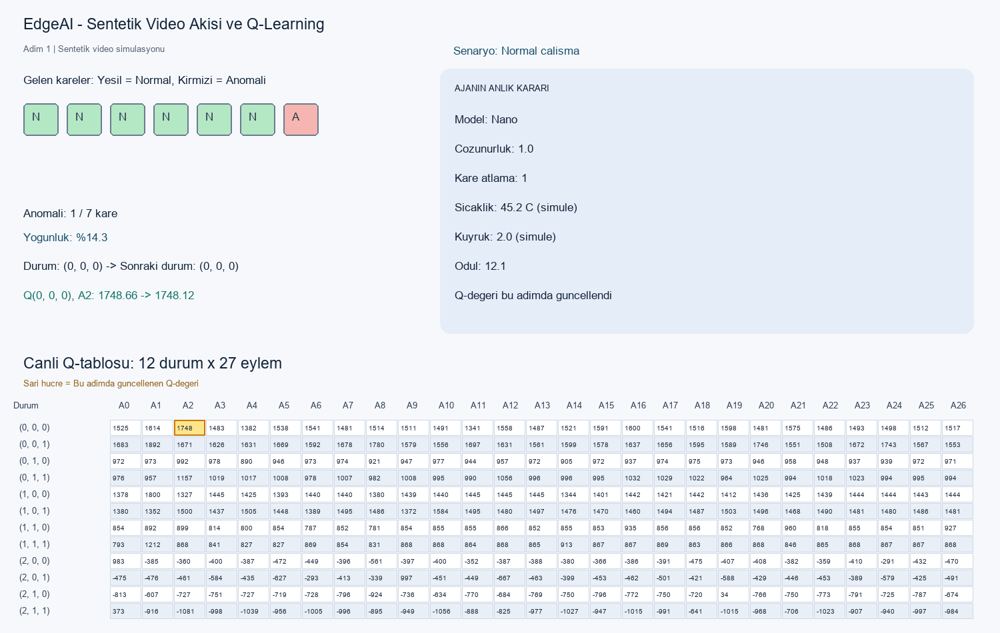
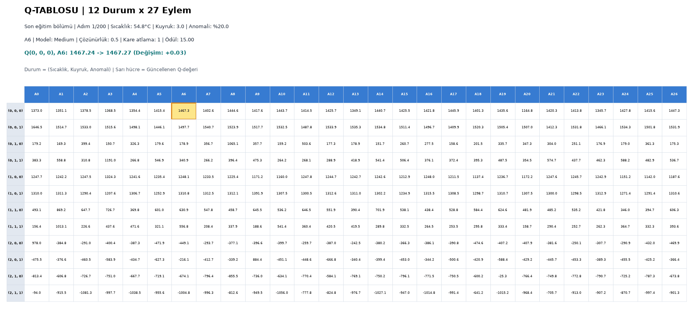

# Uç Cihazlarda (EdgeAI) Gerçek Zamanlı Video Analitiği İçin Termal Duyarlı Çıkarım Yönetimi

Bu proje, uç cihazlarda gerçek zamanlı video analitiği sırasında ortaya çıkabilen termal ısınma, gecikme ve işlem kuyruğu birikmesini klasik Q-Learning yöntemiyle yönetmeyi amaçlamaktadır.

Ajan; sıcaklık, kuyruk uzunluğu ve anomali yoğunluğuna göre model boyutunu, çözünürlüğü ve kare atlama oranını seçer.

**Not:** Bu çalışma gerçek kamera veya donanım üzerinde çalışan bir kusur tespit modeli değildir. Video karelerinin normal/anomali etiketleri, anomali yoğunluğu, donanım sıcaklığı ve gecikme simülasyonda üretilir. Amaç, EdgeAI kaynak yönetiminde Q-Learning algoritmasının karar verme ve öğrenme sürecini somutlaştırmaktır.

## Proje Amacı ve Mimari

Uç cihazlarda artan hesaplama yükü sıcaklığın yükselmesine, işlem gecikmesine ve kuyruk birikmesine yol açabilir. Bu proje problemi bir Markov Karar Süreci (MDP) olarak modeller.

Proje aşağıdaki Python dosyalarından oluşmaktadır:

- **agent.py:** Q-Learning ajanını içerir. Epsilon-greedy stratejisiyle eylem seçimi ve Bellman denklemiyle Q-değerlerinin güncellenmesi gerçekleştirilir.

- **environment.py:** Simülasyon ortamını temsil eder. Sentetik gelen kareler, anomali yoğunluğu, sıcaklık, işlem kuyruğu ve ödül hesaplamalarını gerçekleştirir.

- **main.py:** Ajanın 500, 1000, 2000 ve 3000 bölüm boyunca eğitilmesini, bağımsız testlerin gerçekleştirilmesini, performans grafiklerinin oluşturulmasını ve Q-tablosu animasyonunun hazırlanmasını sağlar.

- **somut_demo.py:** Dört farklı test senaryosunda sentetik video karelerini, anomali yoğunluğunu, ajanın seçtiği eylemleri ve güncellenen Q-tablosunu GIF animasyonu üzerinde gösterir.

## Markov Karar Süreci (MDP) Tasarımı

### Durum Uzayı

Durum uzayı üç temel değişkenden oluşmaktadır.

**1. Sıcaklık**

- S0: Sıcaklık 60°C'nin altında (Düşük).
- S1: Sıcaklık 60°C ile 80°C arasında (Orta).
- S2: Sıcaklık 80°C ve üzerinde (Yüksek).

**2. İşlem Kuyruğu**

- K0: Kuyruk uzunluğu 20'nin altında (Normal).
- K1: Kuyruk uzunluğu 20 ve üzerinde (Yoğun).

**3. Anomali Yoğunluğu**

- A0: Anomali yoğunluğu 0.5'in altında (Düşük).
- A1: Anomali yoğunluğu 0.5 ve üzerinde (Yüksek).

Bu kategoriler sonucunda toplam durum sayısı:

**3 × 2 × 2 = 12 durum**

Not: Durum sınıflandırmasındaki 80°C sınırı ile termal ödül cezasının başladığı 70°C birbirinden farklıdır. Sıcaklık 70°C üzerine çıktığında termal ceza uygulanmaya başlanır.

### Eylem Uzayı

Ajanın eylem uzayı üç temel kontrol parametresinden oluşmaktadır.

**Kare Atlama (Frame Skip):**

- 1
- 2
- 4

**Model Boyutu:**

- Nano
- Small
- Medium

**Çözünürlük:**

- 0.5
- 0.75
- 1.0

Toplam eylem sayısı:

**3 × 3 × 3 = 27 eylem**

Model boyutları ve işlem maliyetleri simülasyon parametreleri olarak temsil edilmektedir.

### Sentetik Video Akışı ve Anomali Yoğunluğu

Simülasyon ortamında her adımda sisteme yeni video kareleri gelmektedir.

Anomali yoğunluğu, anomalili karelerin toplam gelen kare sayısına oranıyla hesaplanmaktadır.

**Anomali Yoğunluğu = Anomalili Kare Sayısı / Toplam Gelen Kare Sayısı**

Örneğin sisteme 10 kare geldiğinde bunların 4 tanesi anomaliliyse:

**Anomali Yoğunluğu = 4 / 10 = %40**

Ajan bu yoğunluk bilgisini sıcaklık ve kuyruk uzunluğuyla birlikte değerlendirerek eylem seçmektedir.

Bu sürümde anomaliler gerçek görüntüler üzerinde çalışan bir görüntü işleme modeliyle tespit edilmemektedir. Normal ve anomalili kare etiketleri simülasyon tarafından oluşturulmaktadır.

### Ödül Fonksiyonu

Ajanın seçtiği eylemler üç farklı ödül bileşeni kullanılarak değerlendirilmektedir.

**1. Anomali Yakalama Ödülü**

Seçilen modelin varsayımsal doğruluk katsayısı, çözünürlük ve kare işleme oranı dikkate alınarak hesaplanmaktadır.

Bu katsayı gerçek bir görüntü sınıflandırma modelinin ölçülmüş doğruluk değeri değildir.

**2. Gecikme Cezası**

İşlem kuyruğu ve hesaplama yüküne bağlı olarak gecikme değeri hesaplanmaktadır.

Gecikmenin 100 birimlik eşik değerini aşması durumunda negatif ödül uygulanmaktadır.

**3. Termal Ceza**

Sıcaklığın 70°C üzerine çıkması durumunda karesel olarak artan bir ceza uygulanmaktadır.

Termal ceza:

`R_thermal = -2 × (T - 70)²`

Bu ceza yalnızca sıcaklık 70°C'nin üzerindeyken uygulanmaktadır.

**Toplam Ödül:**

`R_total = R_anomaly + R_latency + R_thermal`

Ödül fonksiyonu sayesinde ajan, anomali yakalama başarısı ile termal güvenlik ve gecikme arasında denge kurmayı öğrenmektedir.

## Q-Learning Algoritması

Bu projede klasik Q-Learning algoritması kullanılmıştır.

Q-Learning, ajanın ortamla etkileşimi sonucunda elde ettiği ödülleri değerlendirerek durum-eylem çiftlerine ait Q-değerlerini güncellemesini sağlayan bir pekiştirmeli öğrenme yöntemidir.

Q-değerleri Bellman denklemi kullanılarak güncellenmektedir:

`Q(s,a) ← Q(s,a) + α [r + γ max Q(s',a') − Q(s,a)]`

Burada:

- Q(s,a): Mevcut durum-eylem değeri.
- α: Öğrenme oranı.
- r: Alınan ödül.
- γ: İndirim faktörü.
- s': Sonraki durum.
- a': Sonraki durumda seçilebilecek eylem.

Ajan, eğitim sürecinde aldığı ödülleri kullanarak hangi durumda hangi eylemin daha avantajlı olduğunu öğrenmektedir.

### Eğitim Parametreleri

| Parametre | Değer |
|---|---|
| Algoritma | Klasik Q-Learning |
| Eğitim Bölümleri | 500, 1000, 2000, 3000 |
| Bölüm Başına Maksimum Adım | 200 |
| Öğrenme Oranı (Alpha) | 0.1 |
| İndirim Faktörü (Gamma) | 0.99 |
| Başlangıç Keşif Oranı (Epsilon) | 1.0 |
| Epsilon Azalma Katsayısı | 0.995 |
| Minimum Epsilon | 0.02 |
| Durum Sayısı | 12 |
| Eylem Sayısı | 27 |
| Bağımsız Test Bölümü | 50 |

Eğitim bölüm sayıları artırılarak farklı eğitim uzunluklarının ajan performansına etkisi karşılaştırılmıştır.

- 500 bölüm: 100.000 simülasyon adımı
- 1000 bölüm: 200.000 simülasyon adımı
- 2000 bölüm: 400.000 simülasyon adımı
- 3000 bölüm: 600.000 simülasyon adımı

Bu sayılar gerçek video görüntüsü sayısını değil, ajanın simülasyon ortamıyla gerçekleştirdiği etkileşimleri ifade etmektedir.

## Epsilon-Greedy Stratejisi

Ajanın eylem seçiminde epsilon-greedy stratejisi kullanılmaktadır.

- Epsilon olasılığıyla rastgele eylem seçilerek ortam keşfedilir.
- Diğer durumlarda mevcut Q-tablosunda en yüksek değere sahip eylemler tercih edilir.

Eğitim ilerledikçe epsilon değeri her bölümün sonunda azaltılmaktadır.

Bu sayede başlangıçta keşif ağırlıklı davranan ajan, eğitim ilerledikçe öğrenmiş olduğu Q-değerlerine göre karar vermeye yönelmektedir.

Bağımsız test sırasında keşif ve öğrenme kapatılarak ajanın öğrendiği politika değerlendirilmektedir.

## Deneysel Sonuçlar ve Görsel Çıktılar

### Eğitim Grafikleri

Projede 500, 1000, 2000 ve 3000 bölümlük eğitimler gerçekleştirilmiştir.

Eğitim sonuçları Matplotlib kullanılarak görselleştirilmiştir.

Grafiklerde bölüm ödülleri, maksimum sıcaklık, ortalama kuyruk uzunluğu ve ortalama gecikme değerleri gösterilmektedir.

Grafiklerdeki dalgalanmaları daha anlaşılır hâle getirmek amacıyla 50 bölümlük hareketli ortalama kullanılmıştır.

Hareketli ortalama, son 50 bölümün değerlerinin ortalamasını alarak öğrenmenin genel eğilimini göstermektedir.

**Eğitim Ödülü Grafiği**



**Detaylı Eğitim Grafikleri**



**Değerlendirme:**

Eğitimin başlangıcında büyük negatif ödüller gözlemlenmiştir.

Eğitim ilerledikçe ödül hareketli ortalaması genel olarak yükselmiş ve pozitif değerlere ulaşmıştır.

Sıcaklık, kuyruk uzunluğu ve gecikme ortalamalarında iyileşmeler görülmüştür.

Bununla birlikte bazı bölümlerde kritik sıcaklık sınırı aşılmış ve ani ödül düşüşleri devam etmiştir.

Bu durum, ajanın eğitim sırasında her koşulda en iyi kararı veremediğini göstermektedir.

### Eğitim Öncesi ve Sonrası Performans Karşılaştırması

Farklı eğitim uzunluklarının ajan performansına etkisini değerlendirmek amacıyla dört ayrı eğitim gerçekleştirilmiştir.

Her eğitilmiş ajan, 50 bağımsız test bölümünde değerlendirilmiştir.

**Karşılaştırma Sonuçları**

| Eğitim Bölümü | Ortalama Ödül | Kritik Sıcaklık Oranı | Ortalama Gecikme | Ortalama Kuyruk |
|---|---:|---:|---:|---:|
| 500 | 2902.31 | %0 | 212.78 | 40.69 |
| 1000 | 407.54 | %5.1 | 259.71 | 50.16 |
| 2000 | -1155.62 | %0 | 384.89 | 75.29 |
| 3000 | 2295.92 | %0 | 217.23 | 41.72 |

**Performans Karşılaştırma Grafiği**



**Değerlendirme:**

Gerçekleştirilen deneylerde 500 bölümlük eğitim en yüksek ortalama toplam ödülü sağlamıştır.

2000 bölümlük eğitimde kuyruk uzunluğu ve gecikme artmış, buna bağlı olarak toplam ödül azalmıştır.

3000 bölümlük eğitim sonucunda performans yeniden iyileşmiştir.

Bu sonuçlar, eğitim bölüm sayısının artırılmasının her zaman daha yüksek performans sağlamadığını göstermektedir.

Deney sonuçları tek bir rastgele tohum üzerinden elde edilmiştir. Daha güvenilir değerlendirmeler için farklı rastgele tohumlarla tekrarlanan deneyler gerçekleştirilebilir.

### Dört Farklı Test Senaryosu

Q-Learning ajanının farklı sistem koşullarında nasıl karar verdiğini göstermek amacıyla dört farklı senaryo oluşturulmuştur.

**1. Normal Çalışma**

- Başlangıç sıcaklığı: 45°C
- Kuyruk uzunluğu: 5
- Başlangıç anomali olasılığı: %20

**2. Anomali Artışı**

- Başlangıç sıcaklığı: 55°C
- Kuyruk uzunluğu: 15
- Başlangıç anomali olasılığı: %80

**3. Aşırı Isınma**

- Başlangıç sıcaklığı: 85°C
- Kuyruk uzunluğu: 10
- Başlangıç anomali olasılığı: %30

**4. Kuyruk Birikmesi**

- Başlangıç sıcaklığı: 65°C
- Kuyruk uzunluğu: 70
- Başlangıç anomali olasılığı: %60

Bu senaryolar sayesinde ajanın normal çalışma, yüksek anomali yoğunluğu, aşırı ısınma ve kuyruk birikmesi gibi farklı durumlarda nasıl karar verdiği incelenmektedir.

Senaryolar arasında başlangıç koşulları bilinçli olarak yeniden ayarlanmaktadır.

Bu değerler gerçek cihaz üzerinde ölçülen ani sıcaklık değişimleri değildir.

### Sentetik Video Akışı ve Anomali Gösterimi

Projede sentetik video akışının çalışma mantığını somutlaştırmak amacıyla GIF animasyonu oluşturulmuştur.

Animasyonda:

- Yeşil kareler normal görüntüleri,
- Kırmızı kareler anomalili görüntüleri,
- Gelen kare sayısı,
- Anomali yoğunluğu,
- Ajanın seçtiği eylem,
- Simüle sıcaklık,
- Kuyruk uzunluğu,
- Alınan ödül,
- Güncellenen Q-değeri

gösterilmektedir.

**Sentetik Video Akışı ve Q-Learning Animasyonu**



**Değerlendirme:**

Animasyon sayesinde anomali yoğunluğunun nasıl hesaplandığı ve ajanın bu bilgiye bağlı olarak nasıl karar verdiği görsel olarak takip edilebilmektedir.

Ajanın seçtiği eylemler sonucunda aldığı ödüller Q-tablosunun güncellenmesinde kullanılmaktadır.

Bu bölüm, Q-Learning algoritmasının öğrenme mekanizmasını somut olarak göstermektedir.

### Durum-Eylem Karar Tablosu (Q-Table)

Q-Learning algoritmasının öğrendiği durum-eylem değerleri 12×27 boyutlarında bir Q-tablosunda tutulmaktadır.

Tabloda:

- Satırlar sistem durumlarını,
- Sütunlar ajanın seçebileceği eylemleri,
- Hücreler ise ilgili durum-eylem çiftinin Q-değerlerini

temsil etmektedir.

Q-tablosu animasyonunda her adımda güncellenen hücre sarı renkle vurgulanmaktadır.

**Q-Tablosu Animasyonu**



Animasyon üzerinde ajanın seçtiği eylem ve Q-değerinin güncelleme öncesi ve sonrası değerleri gösterilmektedir.

Q-değerlerinin zamanla artması veya azalması, ajanın elde ettiği ödüller doğrultusunda mevcut tahminlerini güncellediğini göstermektedir.

**Not:** Q-tablosu bir karmaşıklık matrisi (Confusion Matrix) değildir. Bu projede gerçek görüntü sınıflandırma tahminleri bulunmadığından TP, FP, TN ve FN üzerinden gerçek anomali tespit başarısı hesaplanmamaktadır.

## Kurulum ve Çalıştırma

Proje Python programlama diliyle geliştirilmiştir.

Gerekli kütüphaneleri yüklemek için:

```bash
pip install -r requirements.txt
```
Ana eğitim ve grafik sonuçlarını oluşturmak için:

```bash
python main.py
```
Dört farklı test senaryosunu çalıştırmak için:

```bash
python somut_demo.py
```
## Sonuç ve Değerlendirme

Bu çalışmada uç cihazlarda gerçek zamanlı video analitiği için termal duyarlı kaynak yönetimi problemi klasik Q-Learning algoritması kullanılarak simülasyon ortamında ele alınmıştır.

Ajanın sıcaklık, kuyruk uzunluğu ve anomali yoğunluğu bilgilerine göre model boyutu, çözünürlük ve kare atlama oranını seçmesi sağlanmıştır.

500, 1000, 2000 ve 3000 bölümlük eğitimler gerçekleştirilerek eğitim uzunluğunun ajan performansına etkisi karşılaştırılmıştır.

Deneysel sonuçlarda ödül değerleri, sıcaklık, gecikme ve kuyruk uzunluğu açısından iyileşmeler gözlemlenmiştir.

Bununla birlikte eğitim bölüm sayısının artırılmasının her zaman daha yüksek performans sağlamadığı belirlenmiştir.

Dört farklı test senaryosuyla ajanın değişen sistem koşullarında verdiği kararlar görselleştirilmiştir.

Ayrıca Q-tablosunun güncellenmesi animasyon üzerinde gösterilerek pekiştirmeli öğrenmenin çalışma mekanizması somutlaştırılmıştır.

Çalışma gerçek bir uç cihaz veya kamera sistemi üzerinde gerçekleştirilmemiştir. Sıcaklık, gecikme ve anomali yoğunluğu simülasyon denklemleriyle temsil edilmiştir.

Elde edilen bulgular, klasik Q-Learning yönteminin simülasyon ortamında termal ve hesaplama kaynaklarının yönetimi için kullanılabileceğini göstermektedir.

Gelecek çalışmalarda gerçek video verileri, eğitilmiş anomali algılama modelleri ve gerçek donanım ölçümleri kullanılarak sistem geliştirilebilir.
